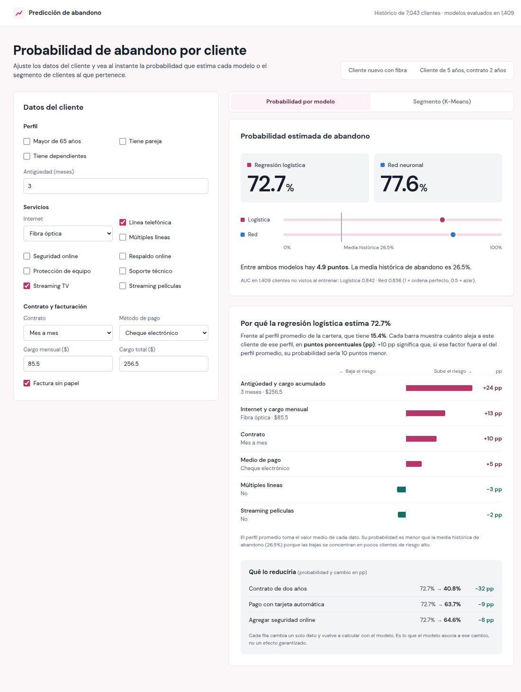
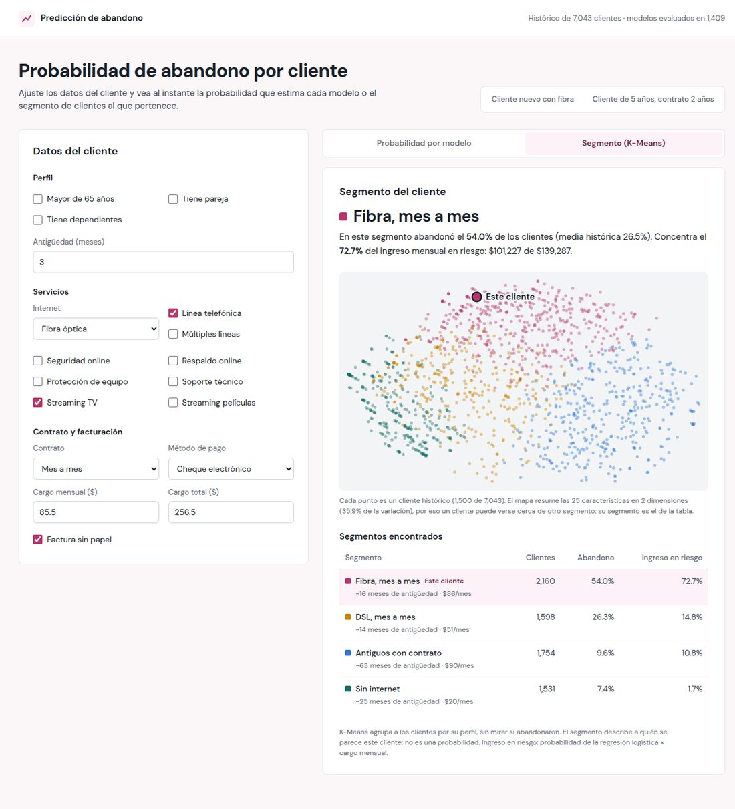

# Predicción de abandono de clientes · Telco

Estimación de la probabilidad de que un cliente de telecomunicaciones se dé de baja, con su explicación
y el segmento de clientes al que pertenece. Incluye el análisis completo (notebooks), dos modelos
supervisados (regresión logística y red neuronal), una segmentación K-Means, una API y una web de demostración.



## Resultados

Evaluado en 1,409 clientes que ningún modelo vio al entrenar (20 % del histórico de 7,043, estratificado):

| | Regresión logística | Red neuronal (32-16) |
|---|---|---|
| AUC (capacidad de ordenar por riesgo) | **0.842** | 0.836 |
| Precisión promedio (AP) | **0.635** | 0.616 |
| Umbral de contacto (por costo) | 0.134 | 0.066 |
| Bajas detectadas | 346 de 374 (93 %) | 362 de 374 (97 %) |
| Costo en el conjunto de prueba | **USD 10,185** | USD 10,455 |

Costo = USD 120 por cada baja no detectada + USD 15 por cada contacto innecesario. Como referencia,
no contactar a nadie cuesta USD 44,880 y contactar a todos, USD 15,525.

**Recomendación: regresión logística.** Cuesta lo mismo que la red (la diferencia no es significativa en
bootstrap), ordena algo mejor y explica cada predicción. Los modelos devuelven solo la probabilidad: el
umbral es una decisión de negocio que se aplica fuera del modelo ([notebook 05](ml/notebooks/05_comparacion_modelos.ipynb)).

K-Means separa la cartera en 4 segmentos accionables. En «Fibra, mes a mes» abandona el 54 % de los
clientes, y el segmento concentra el 73 % del ingreso mensual en riesgo.

## Contenido

1. [Demo rápida con Docker](#1-demo-rápida-con-docker)
2. [Entorno de ciencia de datos](#2-entorno-de-ciencia-de-datos)
3. [Notebooks](#3-notebooks)
4. [Demo local sin Docker](#4-demo-local-sin-docker)
5. [API](#5-api)
6. [Estructura del repositorio](#estructura-del-repositorio)

## Requisitos

| Para | Necesitas |
|---|---|
| Ver la demo | Docker con Docker Compose |
| Notebooks y entrenamiento | Python 3.12 |
| API y web sin Docker | Python 3.12 y Node.js 22 o superior |

```bash
git clone https://github.com/Chappie21/telco-customer-ml.git
cd telco-customer-ml
```

Los comandos de este README son para **macOS y Linux** (bash o zsh) y funcionan igual en ambos.

- **macOS:** `make` viene con las herramientas de línea de comandos de Xcode (`xcode-select --install`).
  Si `python3 --version` no es 3.12, instalarlo con `brew install python@3.12` y usar `python3.12` al crear los entornos.
- **Linux:** `make` suele estar instalado; si no, `sudo apt install make` (Debian/Ubuntu). Para el entorno
  virtual puede hacer falta `sudo apt install python3.12-venv`.
- **Windows** (PowerShell): mismos pasos con estos cambios:

  | macOS / Linux | Windows |
  |---|---|
  | `python3` | `py -3.12` |
  | `.venv/bin/python`, `.venv/bin/pip`, `.venv/bin/uvicorn` | `.venv\Scripts\python`, `.venv\Scripts\pip`, `.venv\Scripts\uvicorn` |
  | `cp .env.example .env.local` | `copy .env.example .env.local` |
  | `make pipeline`, `make notebooks` | ver [Windows sin `make`](#2-entorno-de-ciencia-de-datos) |

## 1. Demo rápida con Docker

Los modelos entrenados vienen incluidos en `ml/models/`; no hace falta entrenar nada.

```bash
cd app
docker compose up --build        # primera vez: unos minutos (instala TensorFlow)
```

| | |
|---|---|
| Web | http://localhost:3000 |
| API | http://localhost:8000/docs (documentación interactiva) |
| Detener | `docker compose down` |

En la web se ingresan los datos de un cliente (o se elige un ejemplo) y se ve al instante:

- **Probabilidad por modelo:** la de cada modelo y, para la logística, qué factores suben o bajan el
  riesgo frente al perfil promedio de la cartera y qué cambio de oferta lo reduciría.
- **Segmento (K-Means):** a qué grupo de clientes se parece y dónde queda en el mapa.

<details>
<summary>Vista de segmentación</summary>



</details>

Si se reentrenan los modelos, volver a ejecutar con `--build`: la imagen de la API copia `ml/models/`.

## 2. Entorno de ciencia de datos

```bash
python3 -m venv ml/.venv
ml/.venv/bin/pip install -r ml/requirements.txt
cd ml
make pipeline     # genera data/clean (no se versiona) y reentrena los modelos
```

`make pipeline` es obligatorio antes de ejecutar los notebooks o la prueba de la API, porque genera
`data/clean/telco_churn_clean.csv`. Reentrenar da exactamente los mismos modelos (semillas fijas).

| Paso | Qué hace | Salidas |
|---|---|---|
| `pipeline.clean` | Limpieza + validaciones de consistencia (aborta si falla alguna) | `data/clean/telco_churn_clean.csv` |
| `pipeline.train_logistic` | Regresión logística, split 80/20 estratificado (seed 42) | `models/churn_logistic.joblib` + `.json` (perfil promedio), `reports/metrics/metrics_logistic.json` |
| `pipeline.train_neural` | Red 32-16 con el mismo test + early stopping | `models/churn_neural.keras` + `.json`, `reports/metrics/metrics_neural.json` |
| `pipeline.train_kmeans` | K-Means (k por silueta + estabilidad) | `models/churn_kmeans.joblib`, `models/kmeans_segments.json`, `reports/tables/clusters_*.csv` |

<details>
<summary>Windows (sin <code>make</code>)</summary>

Desde la raíz del repo, en PowerShell:

```powershell
py -3.12 -m venv ml\.venv
ml\.venv\Scripts\pip install -r ml\requirements.txt
cd ml
.venv\Scripts\python -m pipeline.clean
.venv\Scripts\python -m pipeline.train_logistic
.venv\Scripts\python -m pipeline.train_neural
.venv\Scripts\python -m pipeline.train_kmeans
```

Para ejecutar todos los notebooks (equivale a `make notebooks`), desde `ml/`:

```powershell
.venv\Scripts\jupyter nbconvert --to notebook --execute --inplace --ExecutePreprocessor.timeout=1200 notebooks\*.ipynb
```

</details>

## 3. Notebooks

**Para leerlos** no hace falta nada: se guardaron ya ejecutados, así que en GitHub (o en cualquier editor)
se ven con sus tablas y gráficos.

| Notebook | Contenido |
|---|---|
| [`01_calidad_y_exploracion`](ml/notebooks/01_calidad_y_exploracion.ipynb) | Estructura, calidad, distribuciones y relación de cada variable con el abandono |
| [`02_perfil_de_abandono`](ml/notebooks/02_perfil_de_abandono.ipynb) | Pruebas estadísticas, riesgo relativo, antigüedad, paradoja de Simpson del teléfono, verificación del género |
| [`03_patrones`](ml/notebooks/03_patrones.ipynb) | Combinaciones frecuentes de quien se va / se queda y segmentos de un árbol de decisión |
| [`04_segmentacion_kmeans`](ml/notebooks/04_segmentacion_kmeans.ipynb) | Elección de k, segmentos, ingreso en riesgo, mapa y perfil |
| [`05_comparacion_modelos`](ml/notebooks/05_comparacion_modelos.ipynb) | AUC y sobreajuste, umbral por costo, bootstrap, arquitecturas 32-16 vs 64-32-16, interacciones |

Cada uno guarda sus figuras en `ml/reports/figures/<sección>/` y sus tablas en `ml/reports/tables/`.
Reportes de análisis: [`reporte_exploratorio_churn.md`](ml/reports/reporte_exploratorio_churn.md) (y `.pdf`)
y [`reporte_patrones.md`](ml/reports/reporte_patrones.md).

**Para ejecutarlos** (requiere el paso 2):

- **VS Code:** abrir un notebook de `ml/notebooks/`, *Select Kernel* → *Python Environments* →
  `ml/.venv/bin/python` (instalar la extensión *Jupyter* si la pide) y *Run All*.
- **JupyterLab:**
  ```bash
  ml/.venv/bin/pip install jupyterlab
  ml/.venv/bin/jupyter lab ml/notebooks
  ```
- **Todos de una vez:** `cd ml && make notebooks` (los ejecuta en orden y guarda los resultados, ~2 min).

`make all` reproduce todo desde `data/raw` (pipeline + notebooks, ~3 min).

## 4. Demo local sin Docker

Terminal 1, la API:

```bash
cd app/api
python3 -m venv .venv && .venv/bin/pip install -r requirements.txt
.venv/bin/uvicorn src.main:app --reload       # http://127.0.0.1:8000/docs
```

Terminal 2, la web:

```bash
cd app/frontend
cp .env.example .env.local                    # NEXT_PUBLIC_API_URL=http://127.0.0.1:8000
npm install
npm run dev                                   # http://localhost:3000
```

Prueba de la API (requiere `data/clean`, ver paso 2):

```bash
cd app/api && .venv/bin/python -m tests.test_predict
```

Comprueba, con 50 clientes reales, que la API da las mismas probabilidades y segmentos que los modelos y
que los aportes de `/explain` reconstruyen exactamente la probabilidad. También verifica que rechaza
datos inválidos y que CORS funciona.

## 5. API

| Método | Ruta | Devuelve |
|---|---|---|
| `GET` | `/health` | Estado y modelos cargados |
| `POST` | `/predict` | Probabilidad de abandono de cada modelo (`churn_probability`) |
| `POST` | `/explain` | Por qué la logística estima esa probabilidad: aporte de cada variable y acciones que la reducirían |
| `GET` | `/segments` | Segmentos K-Means (clientes, abandono, ingreso en riesgo) y muestra del mapa 2D |
| `POST` | `/segment` | Segmento del cliente y su posición en el mapa |

Los `POST` reciben el mismo cuerpo: los datos de un cliente.

```bash
curl -X POST http://localhost:8000/predict -H 'content-type: application/json' -d '{
  "senior_citizen": 0, "partner": 0, "dependents": 0, "tenure": 1,
  "phone_service": 1, "multiple_lines": 0, "online_security": 0, "online_backup": 0,
  "device_protection": 0, "tech_support": 0, "streaming_tv": 0, "streaming_movies": 0,
  "paperless_billing": 1, "monthly_charges": 70.7, "total_charges": 70.7,
  "internet_service": "fiber_optic", "contract": "month_to_month", "payment_method": "electronic_check"}'
# {"logistic_regression":{"churn_probability":0.7023},"neural_network":{"churn_probability":0.6972}}
```

Con el umbral recomendado (0.134) este cliente se contactaría. Enviado a `/segment`, el mismo cuerpo
devuelve «Fibra, mes a mes».

<details>
<summary>Cómo funciona <code>/explain</code></summary>

La regresión logística suma el aporte de cada variable, así que la explicación es exacta (sin aproximaciones):

- **`log_odds`:** aporte de cada variable frente al perfil promedio de entrenamiento. Sumados,
  reconstruyen exactamente la probabilidad.
- **`points`:** el mismo aporte en puntos porcentuales: cuánto bajaría la probabilidad si ese factor fuera
  el del perfil promedio.
- **`actions`:** probabilidad si solo cambia un dato que una oferta puede mover (contrato, pago
  automático, servicios de protección y soporte). Es lo que el modelo asocia a ese cambio, no un efecto causal.

Antigüedad y cargo acumulado, y servicio de internet y cargo mensual, se agrupan: están muy correlacionados
y por separado el modelo reparte su efecto con signos opuestos. La red neuronal no tiene una descomposición
exacta por variable, por eso solo se explica la logística.

</details>

Variables de entorno: `LOGISTIC_MODEL`, `NEURAL_MODEL`, `KMEANS_MODEL`, `KMEANS_SEGMENTS` (rutas de los
modelos) y `CORS_ORIGINS` (por defecto `http://localhost:3000`).

## Estructura del repositorio

```
data/raw/              CSV original (inmutable)
data/clean/            dataset limpio (lo genera ml/pipeline/clean.py; no se versiona)
ml/                    ciencia de datos (venv propio: ml/.venv)
  Makefile             make all = pipeline + notebooks (reproduce todo desde data/raw)
  telco/               código compartido: rutas, carga de datos + split único, estilo de gráficos
  pipeline/            scripts que PRODUCEN artefactos: limpieza y entrenamiento
  notebooks/           análisis que EXPLICA decisiones, con resultados guardados (01 → 05)
  models/              modelos entrenados (los copia la API)
  reports/
    figures/<sección>/ exploracion · perfil · patrones · segmentacion · modelos
    tables/            CSV de resultados
    metrics/           métricas de cada modelo (JSON)
    *.md / *.pdf       reportes de análisis
app/
  api/                 FastAPI: sirve los 2 modelos, la explicación y K-Means (venv propio: app/api/.venv)
    src/               main · core/config · routes · schemas · services · utils
    tests/
  frontend/            Next.js: demo de probabilidad, explicación y segmento
    src/               app · components · lib · types · utils
docs/                  capturas de la web para este README
```
