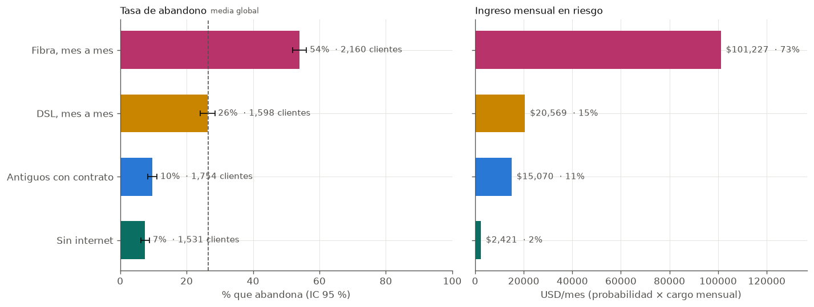

# Análisis exploratorio del abandono de clientes de telecomunicaciones

Este informe describe la cartera entregada y los patrones de abandono observados antes de proponer un modelo predictivo. La unidad de análisis es el cliente. Las tasas expresan asociaciones en la muestra.

## Composición y calidad

El archivo contiene **7,043 clientes y 21 columnas**. Abandonaron **1,869 (26,54 %)** y permanecieron **5,174 (73,46 %)**. Hay 0 filas duplicadas y 0 identificadores duplicados.
Los 11 cargos acumulados vacíos corresponden a clientes con antigüedad cero. Para resumir el campo original se mantienen como faltantes. La limpieza existente les asigna cero y codifica las categorías para reproducir los clusters.

| Columna original | Significado | Tipo | Categorías o rango | Faltantes |
|---|---|---|---|---:|
| `customerID` | Identificador del cliente | Identificador | 7,043 únicos | 0 |
| `gender` | Género registrado | Categórica | Female, Male | 0 |
| `SeniorCitizen` | Indicador de cliente sénior | Categórica | 0, 1 | 0 |
| `Partner` | Tiene pareja | Categórica | No, Yes | 0 |
| `Dependents` | Tiene dependientes | Categórica | No, Yes | 0 |
| `tenure` | Antigüedad en meses | Numérica | 0,00–72,00 | 0 |
| `PhoneService` | Servicio telefónico | Categórica | No, Yes | 0 |
| `MultipleLines` | Múltiples líneas | Categórica | No, No phone service, Yes | 0 |
| `InternetService` | Tipo de internet | Categórica | DSL, Fiber optic, No | 0 |
| `OnlineSecurity` | Seguridad en línea | Categórica | No, No internet service, Yes | 0 |
| `OnlineBackup` | Respaldo en línea | Categórica | No, No internet service, Yes | 0 |
| `DeviceProtection` | Protección de dispositivos | Categórica | No, No internet service, Yes | 0 |
| `TechSupport` | Soporte técnico | Categórica | No, No internet service, Yes | 0 |
| `StreamingTV` | Streaming de TV | Categórica | No, No internet service, Yes | 0 |
| `StreamingMovies` | Streaming de películas | Categórica | No, No internet service, Yes | 0 |
| `Contract` | Duración del contrato | Categórica | Month-to-month, One year, Two year | 0 |
| `PaperlessBilling` | Factura electrónica | Categórica | No, Yes | 0 |
| `PaymentMethod` | Medio de pago | Categórica | Bank transfer (automatic), Credit card (automatic), Electronic check, Mailed check | 0 |
| `MonthlyCharges` | Cargo mensual | Numérica | 18,25–118,75 | 0 |
| `TotalCharges` | Cargo acumulado | Numérica | 18,80–8684,80 | 11 |
| `Churn` | Abandono registrado | Categórica | No, Yes | 0 |

## Asociación observada con el abandono

Las tasas categóricas usan como denominador los clientes de cada categoría. V de Cramér resume la asociación de la variable completa con el abandono en una escala de 0 a 1. Las categorías «No internet service» y «No phone service» conservan el significado que tienen en el CSV.

| Variable | V de Cramér | Categorías con clientes, bajas y tasa |
|---|---:|---|
| `gender` | 0,01 | Female (3,488, 939, 26,92 %) · Male (3,555, 930, 26,16 %) |
| `SeniorCitizen` | 0,15 | 0 (5,901, 1,393, 23,61 %) · 1 (1,142, 476, 41,68 %) |
| `Partner` | 0,15 | No (3,641, 1,200, 32,96 %) · Yes (3,402, 669, 19,66 %) |
| `Dependents` | 0,16 | No (4,933, 1,543, 31,28 %) · Yes (2,110, 326, 15,45 %) |
| `PhoneService` | 0,01 | No (682, 170, 24,93 %) · Yes (6,361, 1,699, 26,71 %) |
| `MultipleLines` | 0,04 | No (3,390, 849, 25,04 %) · No phone service (682, 170, 24,93 %) · Yes (2,971, 850, 28,61 %) |
| `InternetService` | 0,32 | DSL (2,421, 459, 18,96 %) · Fiber optic (3,096, 1,297, 41,89 %) · No (1,526, 113, 7,40 %) |
| `OnlineSecurity` | 0,35 | No (3,498, 1,461, 41,77 %) · No internet service (1,526, 113, 7,40 %) · Yes (2,019, 295, 14,61 %) |
| `OnlineBackup` | 0,29 | No (3,088, 1,233, 39,93 %) · No internet service (1,526, 113, 7,40 %) · Yes (2,429, 523, 21,53 %) |
| `DeviceProtection` | 0,28 | No (3,095, 1,211, 39,13 %) · No internet service (1,526, 113, 7,40 %) · Yes (2,422, 545, 22,50 %) |
| `TechSupport` | 0,34 | No (3,473, 1,446, 41,64 %) · No internet service (1,526, 113, 7,40 %) · Yes (2,044, 310, 15,17 %) |
| `StreamingTV` | 0,23 | No (2,810, 942, 33,52 %) · No internet service (1,526, 113, 7,40 %) · Yes (2,707, 814, 30,07 %) |
| `StreamingMovies` | 0,23 | No (2,785, 938, 33,68 %) · No internet service (1,526, 113, 7,40 %) · Yes (2,732, 818, 29,94 %) |
| `Contract` | 0,41 | Month-to-month (3,875, 1,655, 42,71 %) · One year (1,473, 166, 11,27 %) · Two year (1,695, 48, 2,83 %) |
| `PaperlessBilling` | 0,19 | No (2,872, 469, 16,33 %) · Yes (4,171, 1,400, 33,57 %) |
| `PaymentMethod` | 0,30 | Bank transfer (automatic) (1,544, 258, 16,71 %) · Credit card (automatic) (1,522, 232, 15,24 %) · Electronic check (2,365, 1,071, 45,29 %) · Mailed check (1,612, 308, 19,11 %) |

Para las variables numéricas, se muestran mediana y rango intercuartílico (P25–P75). La correlación biserial por rangos compara ambas distribuciones. Un valor negativo indica valores generalmente menores entre quienes abandonaron.

| Variable | Abandonó | Permaneció | Correlación por rangos |
|---|---:|---:|---:|
| `tenure` | 10,00 [2,00–29,00] | 38,00 [15,00–61,00] | -0,48 |
| `MonthlyCharges` | 79,65 [56,15–94,20] | 64,43 [25,10–88,40] | 0,24 |
| `TotalCharges` | 703,55 [134,50–2331,30] | 1683,60 [577,83–4264,12] | -0,30 |

Las asociaciones categóricas más altas corresponden a `Contract` (0,41), `OnlineSecurity` (0,35), `TechSupport` (0,34), `InternetService` (0,32). La baja antigüedad también caracteriza al grupo que abandona. El cargo acumulado depende del tiempo de permanencia y los cargos históricos, por lo que conviene interpretar ambos juntos.

**Variables con poco aporte descriptivo global.** `customerID` identifica filas y `Churn` es el resultado observado. `gender` presenta una asociación global pequeña (V = 0,01). `PhoneService` también tiene una asociación global pequeña (V = 0,01), pero entre clientes DSL la tasa es 24,93 % sin teléfono y 16,62 % con teléfono. `MultipleLines` combina la disponibilidad de teléfono con el número de líneas. Su interpretación depende del servicio contratado.

## Patrones en los cuatro clusters K-Means

Se reprodujo la asignación guardada en el repositorio y se unieron los clusters al CSV original usando el identificador. K-Means agrupó por características del cliente. La numeración existente ordena los clusters por abandono observado. El lift es la tasa del cluster dividida por la tasa global. La cobertura es la proporción de todas las bajas que aporta el cluster.

| Cluster | Clientes | % de clientes | Bajas | Tasa | IC 95 % (Wilson) | Lift | Cobertura |
|---|---:|---:|---:|---:|---:|---:|---:|
| 1 · Fibra, mes a mes | 2,160 | 30,67 % | 1,167 | 54,03 % | 51,92 %–56,12 % | 2,04× | 62,44 % |
| 2 · DSL, mes a mes | 1,598 | 22,69 % | 420 | 26,28 % | 24,18 %–28,50 % | 0,99× | 22,47 % |
| 3 · Antiguos con contrato | 1,754 | 24,90 % | 169 | 9,64 % | 8,34 %–11,11 % | 0,36× | 9,04 % |
| 4 · Sin internet | 1,531 | 21,74 % | 113 | 7,38 % | 6,18 %–8,80 % | 0,28× | 6,05 % |

### Cluster 1 · Fibra, mes a mes

**Perfil del grupo.** fibra óptica 100% (total 44%). mes a mes 96% (total 55%). DSL 0% (total 34%). cheque electrónico 63% (total 34%).

| Rasgos con mayor diferencia positiva | Clientes con / resto | Tasa con / resto | Diferencia en pp |
|---|---:|---:|---:|
| `Contract` = Month-to-month | 2,082 / 78 | 55,24 % / 21,79 % | 33,44 |
| `OnlineSecurity` = No | 1,831 / 329 | 56,85 % / 38,30 % | 18,56 |
| `TechSupport` = No | 1,841 / 319 | 56,65 % / 38,87 % | 17,78 |
| `PaymentMethod` = Electronic check | 1,356 / 804 | 59,07 % / 45,52 % | 13,55 |

**Medianas de quienes abandonan frente a quienes permanecen.** `tenure` 10,00 / 25,00 · `MonthlyCharges` 85,35 / 86,45 · `TotalCharges` 868,50 / 2162,60.

### Cluster 2 · DSL, mes a mes

**Perfil del grupo.** DSL 100% (total 34%). fibra óptica 0% (total 44%). múltiples líneas 15% (total 42%). línea telefónica 67% (total 90%).

| Rasgos con mayor diferencia positiva | Clientes con / resto | Tasa con / resto | Diferencia en pp |
|---|---:|---:|---:|
| `Contract` = Month-to-month | 1,202 / 396 | 32,70 % / 6,82 % | 25,88 |
| `OnlineSecurity` = No | 1,010 / 588 | 32,77 % / 15,14 % | 17,64 |
| `PaymentMethod` = Electronic check | 546 / 1,052 | 36,45 % / 21,01 % | 15,44 |
| `TechSupport` = No | 1,062 / 536 | 31,26 % / 16,42 % | 14,84 |

**Medianas de quienes abandonan frente a quienes permanecen.** `tenure` 4,00 / 20,00 · `MonthlyCharges` 48,45 / 51,38 · `TotalCharges` 197,47 / 996,85.

### Cluster 3 · Antiguos con contrato

**Perfil del grupo.** mes a mes 4% (total 55%). protección equipo 76% (total 34%). soporte técnico 68% (total 29%). streaming películas 77% (total 39%).

| Rasgos con mayor diferencia positiva | Clientes con / resto | Tasa con / resto | Diferencia en pp |
|---|---:|---:|---:|
| `Contract` = One year | 727 / 1,027 | 15,96 % / 5,16 % | 10,80 |
| `InternetService` = Fiber optic | 931 / 823 | 13,96 % / 4,74 % | 9,22 |
| `PaymentMethod` = Electronic check | 341 / 1,413 | 16,42 % / 8,00 % | 8,43 |
| `StreamingMovies` = Yes | 1,353 / 401 | 11,23 % / 4,24 % | 6,99 |

**Medianas de quienes abandonan frente a quienes permanecen.** `tenure` 57,00 / 64,00 · `MonthlyCharges` 103,75 / 89,55 · `TotalCharges` 5510,65 / 5265,50.

### Cluster 4 · Sin internet

**Perfil del grupo.** sin internet 100% (total 22%). fibra óptica 0% (total 44%). cargo mensual ($) 20 (total 70). streaming películas 0% (total 39%).

| Rasgos con mayor diferencia positiva | Clientes con / resto | Tasa con / resto | Diferencia en pp |
|---|---:|---:|---:|
| `Contract` = Month-to-month | 525 / 1,006 | 18,86 % / 1,39 % | 17,47 |
| `Partner` = No | 789 / 742 | 10,65 % / 3,91 % | 6,74 |
| `MultipleLines` = No | 1,189 / 342 | 8,66 % / 2,92 % | 5,74 |
| `PaymentMethod` = Electronic check | 122 / 1,409 | 12,30 % / 6,96 % | 5,34 |

**Medianas de quienes abandonan frente a quienes permanecen.** `tenure` 1,00 / 28,00 · `MonthlyCharges` 20,00 / 20,15 · `TotalCharges` 21,00 / 592,92.

Las comparaciones dentro de cluster requieren al menos 50 clientes en la categoría y 50 en el resto del grupo. Se muestra una categoría por variable y se ordena por diferencia positiva de tasa. Son contrastes exploratorios sin ajuste por otras variables ni por comparaciones múltiples.

## Lectura de los patrones

El **cluster 1** reúne 30,67 % de la cartera y concentra **62,44 % de las bajas**. La fibra describe su composición. Dentro de un perfil homogéneo en tipo de internet, cobran relevancia los contrastes de contrato, antigüedad, servicios adicionales y pago.

- Entre clientes con fibra y contrato mensual de **hasta 15 meses**, abandonó el 70,66 % con cheque electrónico (501/709) y el 66,06 % con otros métodos (216/327).
- Entre clientes con fibra y contrato mensual de **más de 15 meses**, abandonó el 48,16 % con cheque electrónico (288/598) y el 31,78 % con otros métodos (157/494).

La diferencia por medio de pago es mayor entre clientes con más de 15 meses. Los contrastes son observacionales y pueden reflejar otras diferencias entre clientes. Las tasas e intervalos corresponden a los grupos de esta muestra.

## Fuentes

- [CSV original](../../data/raw/telco-customer-churn.csv) y [CSV limpio](../../data/clean/telco_churn_clean.csv)
- [Reglas de limpieza](../pipeline/clean.py), [procedimiento de K-Means](../pipeline/train_kmeans.py) y [análisis de segmentos](../notebooks/04_segmentacion_kmeans.ipynb)
- [Resumen de clusters](tables/clusters_segmentos.csv)
