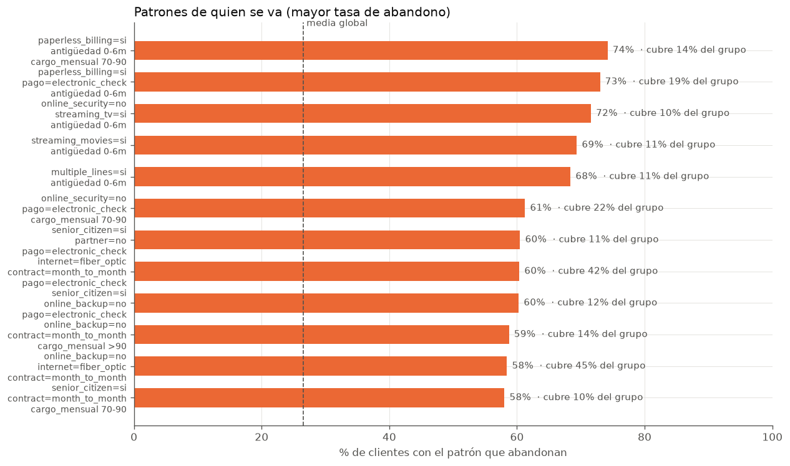
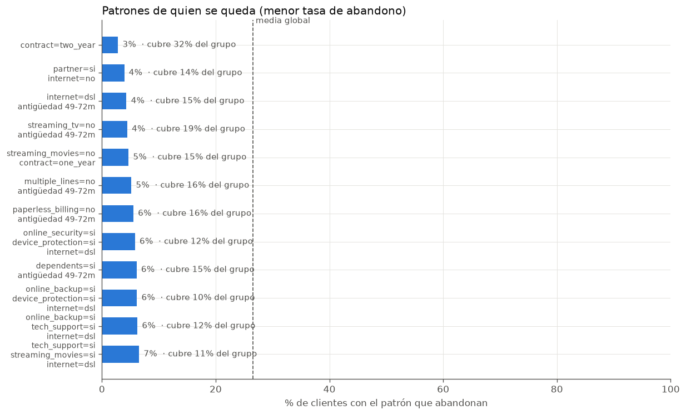
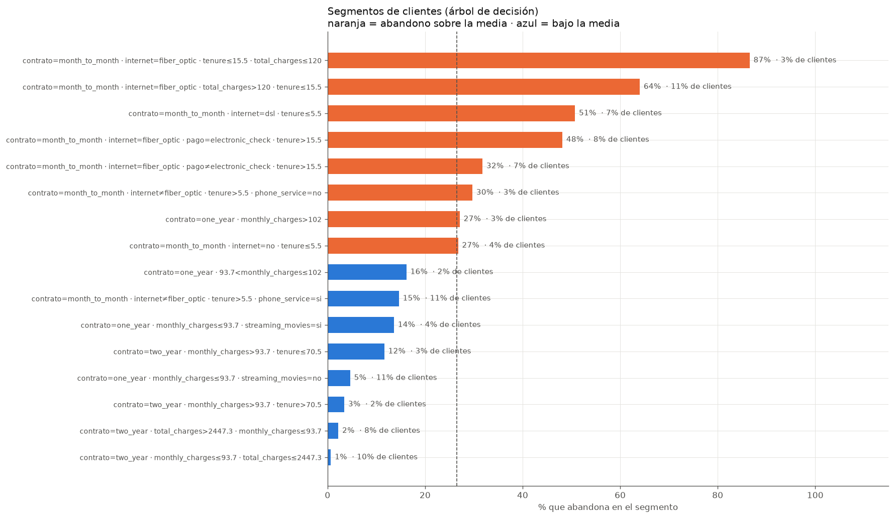

# Reporte: ¿quién abandona y quién se queda?

Dataset: 7,043 clientes · **1,869 abandonan (26.5%)** · 5,174 se quedan (73.5%).
Fuente: `data/clean/telco_churn_clean.csv`. Notebooks: `ml/notebooks/02_perfil_de_abandono.ipynb` (perfil y género) y `03_patrones.ipynb`.

---

## Cómo leer las tablas (importante)

Cada tabla tiene dos números que responden **preguntas distintas**:

| Columna | Pregunta que responde | Se calcula sobre |
|---|---|---|
| **% abandona** | *Si un cliente tiene este patrón, ¿qué tan probable es que se vaya?* | los clientes **que tienen el patrón** |
| **Cubre (% del grupo)** | *¿Qué tan común es este patrón dentro del grupo?* | **todos** los que se van (o todos los que se quedan) |

**Ejemplo con el patrón "fibra óptica + mes a mes + electronic check":**

- 1,307 clientes tienen ese patrón. De ellos, 789 se fueron → **% abandona = 60%**.
- En total se fueron 1,869 clientes. De esos 1,869, 789 tenían este patrón → **cubre el 42% de los que se van**.

Es decir: un patrón puede ser **muy peligroso pero raro** (alto % abandona, baja cobertura), o **algo menos peligroso pero muy común** (cobertura alta). Para negocio, los que más importan son los que tienen **ambos** altos, porque explican a muchos clientes perdidos.

> Referencia: la tasa media de abandono es **26.5%**. Todo patrón por encima es de riesgo, por debajo es de retención.

---

## 1. ¿La columna `gender` aporta algo? → No

| Prueba | Resultado |
|---|---|
| Diferencia global | Mujeres 26.9% vs hombres 26.2% de abandono (p = 0.49, no significativo) |
| Efecto oculto dentro de subgrupos | 52 subgrupos probados (antigüedad, cargo, contrato, servicios…): **0 significativos** tras corrección Bonferroni |
| Aporte a un modelo (AUC, validación cruzada) | Regresión logística 0.8451 con / 0.8452 sin · Gradient boosting 0.8360 con / 0.8356 sin → diferencia = ruido |

**Decisión:** `gender` no se usará como variable del modelo.

## 2. `phone_service` parece no aportar, pero sí aporta

A nivel global no hay diferencia (24.9% sin teléfono vs 26.7% con teléfono). El motivo: **todos** los clientes sin teléfono tienen internet DSL, mientras que el grupo con teléfono mezcla fibra óptica (41.9% de abandono) con clientes sin internet (7.4%), y esos extremos se compensan (paradoja de Simpson).

Comparando **solo clientes DSL**:

| Internet DSL | Clientes | % abandona |
|---|---|---|
| Sin teléfono | 682 | **24.9%** |
| Con teléfono | 1,739 | **16.6%** |

Diferencia de 8 puntos, p = 0.000004. **Decisión:** `phone_service` se mantiene.

---

## 3. Patrones de quien SE VA

"Cubre" = % de los **1,869 clientes que abandonaron** que tienen este patrón.

| # | Patrón | Clientes con el patrón | % abandona | Cubre (% de los que se van) |
|---|---|---|---|---|
| 1 | Factura sin papel + antigüedad 0-6 meses + cargo mensual $70-90 | 341 | **74%** | 14% |
| 2 | Factura sin papel + electronic check + antigüedad 0-6 meses | 489 | **73%** | 19% |
| 3 | Sin seguridad online + streaming TV + antigüedad 0-6 meses | 264 | **72%** | 10% |
| 4 | Streaming películas + antigüedad 0-6 meses | 284 | **69%** | 11% |
| 5 | Múltiples líneas + antigüedad 0-6 meses | 291 | **68%** | 11% |
| 6 | Sin seguridad online + electronic check + cargo $70-90 | 684 | **61%** | 22% |
| 7 | Senior + sin pareja + electronic check | 329 | **60%** | 11% |
| 8 | **Fibra óptica + mes a mes + electronic check** | 1,307 | **60%** | **42%** |
| 9 | Senior + sin respaldo online + electronic check | 375 | **60%** | 12% |
| 10 | Sin respaldo online + mes a mes + cargo > $90 | 446 | **59%** | 14% |
| 11 | **Sin respaldo online + fibra óptica + mes a mes** | 1,436 | **58%** | **45%** |
| 12 | Senior + mes a mes + cargo $70-90 | 336 | **58%** | 10% |

**Lectura:**

- Los patrones 1-5 son los **más peligrosos** (~70% se va), pero cada uno explica solo 10-19% de las bajas: el cliente **nuevo (0-6 meses)** es el más frágil.
- Los patrones 8 y 11 son algo menos peligrosos (~60%) pero **explican casi la mitad de todas las bajas**: el combo **fibra óptica + contrato mes a mes** es el problema más grande en volumen.

## 4. Patrones de quien SE QUEDA

"Cubre" = % de los **5,174 clientes que se quedaron** que tienen este patrón.

| # | Patrón | Clientes con el patrón | % abandona | Cubre (% de los que se quedan) |
|---|---|---|---|---|
| 1 | **Contrato a 2 años** | 1,695 | **2.8%** | **32%** |
| 2 | Con pareja + sin internet | 738 | 3.9% | 14% |
| 3 | Internet DSL + antigüedad 49-72 meses | 788 | 4.3% | 15% |
| 4 | Sin streaming TV + antigüedad 49-72 meses | 1,010 | 4.5% | 19% |
| 5 | Sin streaming películas + contrato a 1 año | 811 | 4.7% | 15% |
| 6 | Sin múltiples líneas + antigüedad 49-72 meses | 851 | 5.2% | 16% |
| 7 | Factura en papel + antigüedad 49-72 meses | 902 | 5.5% | 16% |
| 8 | Seguridad online + protección de dispositivo + DSL | 636 | 5.8% | 12% |
| 9 | Con dependientes + antigüedad 49-72 meses | 853 | 6.1% | 15% |
| 10 | Respaldo online + protección de dispositivo + DSL | 568 | 6.2% | 10% |
| 11 | Respaldo online + soporte técnico + DSL | 640 | 6.3% | 12% |
| 12 | Soporte técnico + streaming películas + DSL | 597 | 6.5% | 11% |

**Lectura:** el contrato a 2 años por sí solo retiene a 1 de cada 3 clientes fieles con apenas 2.8% de abandono. Le siguen: mucha antigüedad (4+ años), clientes DSL con servicios de protección/soporte contratados, y clientes con familia sin internet.

---

## 5. Segmentos (árbol de decisión)

A diferencia de los patrones (que se pueden solapar), aquí **cada cliente cae en exactamente un segmento** y entre todos suman el 100% de clientes y el 100% de bajas.

Columnas:

- **% de clientes**: qué parte de los 7,043 clientes está en el segmento.
- **% abandona**: de los clientes del segmento, cuántos se fueron.
- **% de todas las bajas**: de los 1,869 que se fueron, cuántos vienen de este segmento. *(Es el equivalente a "cubre" de las tablas anteriores.)*

| # | Segmento | Clientes | % de clientes | % abandona | % de todas las bajas |
|---|---|---|---|---|---|
| 1 | Mes a mes · fibra · antigüedad ≤ 15 meses · cargo total ≤ $120 | 238 | 3.4% | **87%** | 11.0% |
| 2 | Mes a mes · fibra · antigüedad ≤ 15 meses · cargo total > $120 | 798 | 11.3% | **64%** | **27.3%** |
| 3 | Mes a mes · DSL · antigüedad ≤ 5 meses | 463 | 6.6% | **51%** | 12.6% |
| 4 | Mes a mes · fibra · electronic check · antigüedad > 15 meses | 598 | 8.5% | **48%** | 15.4% |
| 5 | Mes a mes · fibra · otro pago · antigüedad > 15 meses | 494 | 7.0% | 32% | 8.4% |
| 6 | Mes a mes · sin fibra · antigüedad > 5 meses · **sin teléfono** | 239 | 3.4% | 30% | 3.8% |
| 7 | Contrato 1 año · cargo mensual > $102 | 225 | 3.2% | 27% | 3.3% |
| 8 | Mes a mes · sin internet · antigüedad ≤ 5 meses | 280 | 4.0% | 27% | 4.0% |
| 9 | Contrato 1 año · cargo mensual $93.7-102 | 173 | 2.5% | 16% | 1.5% |
| 10 | Mes a mes · sin fibra · antigüedad > 5 meses · **con teléfono** | 765 | 10.9% | 15% | 6.0% |
| 11 | Contrato 1 año · cargo ≤ $93.7 · streaming películas | 301 | 4.3% | 14% | 2.2% |
| 12 | Contrato 2 años · cargo > $93.7 · antigüedad ≤ 70 meses | 206 | 2.9% | 12% | 1.3% |
| 13 | Contrato 1 año · cargo ≤ $93.7 · sin streaming películas | 774 | 11.0% | 4.7% | 1.9% |
| 14 | Contrato 2 años · cargo > $93.7 · antigüedad > 70 meses | 174 | 2.5% | 3.4% | 0.3% |
| 15 | Contrato 2 años · cargo ≤ $93.7 · cargo total > $2,447 | 585 | 8.3% | 2.2% | 0.7% |
| 16 | Contrato 2 años · cargo ≤ $93.7 · cargo total ≤ $2,447 | 730 | 10.4% | 0.7% | 0.3% |

**Lectura:**

- Segmentos 1 + 2 (**mes a mes + fibra + menos de 16 meses**): son el 14.7% de los clientes pero generan el **38% de todas las bajas**. Es el grupo prioritario para retención.
- Segmentos 1-4 juntos: 30% de los clientes → **66% de las bajas**.
- Segmentos 6 vs 10 confirman el efecto de `phone_service`: mismo perfil, sin teléfono 30% de abandono vs con teléfono 15%.
- Segmentos 13-16 (contratos largos con cargo moderado): 32% de los clientes y solo 3% de las bajas.

---

## 6. Resumen

**Perfil de quien se va:** cliente nuevo (< 6-15 meses), contrato mes a mes, fibra óptica, paga con electronic check, factura sin papel y sin servicios de protección (seguridad online, respaldo, soporte técnico).

**Perfil de quien se queda:** contrato a 1-2 años, o más de 4 años de antigüedad, o cliente DSL con servicios de protección/soporte, o cliente con familia sin internet.

## 7. Próximo paso: modelo

- Se excluye `gender_male` como variable de entrada; `customer_id` solo identifica al cliente.
- La división entrenamiento/prueba se hará con scikit-learn (`train_test_split`, estratificado por `churn`) dentro del script de entrenamiento, sin guardar archivos intermedios.
- El escalado de variables numéricas se ajustará solo con los datos de entrenamiento, dentro del pipeline del modelo.
